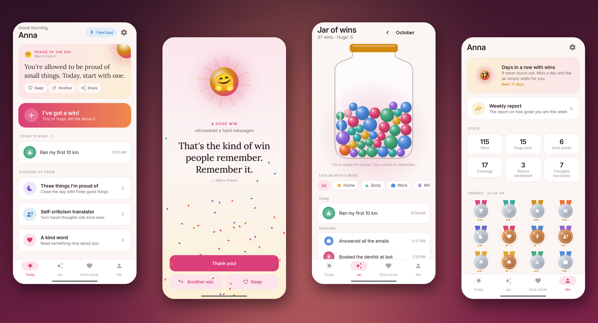
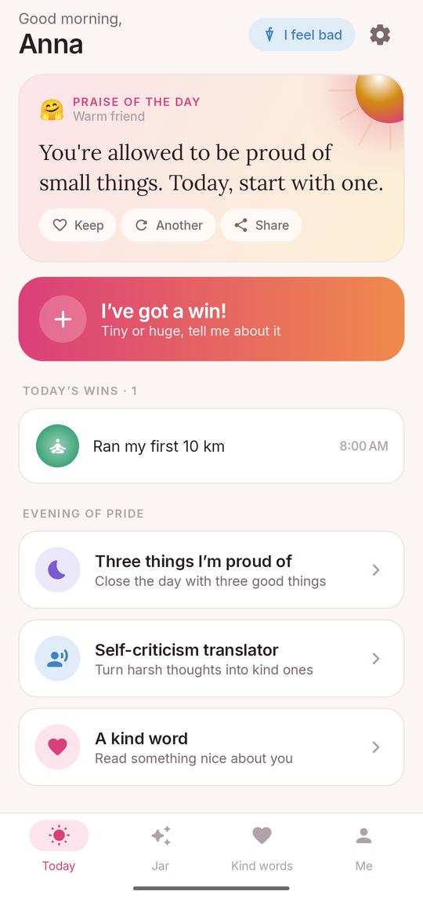
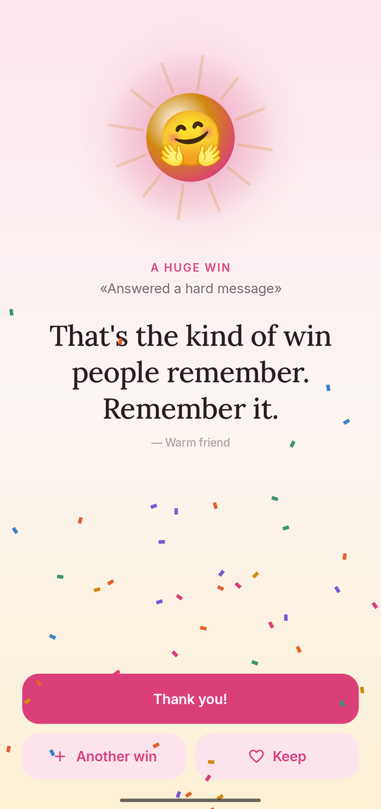
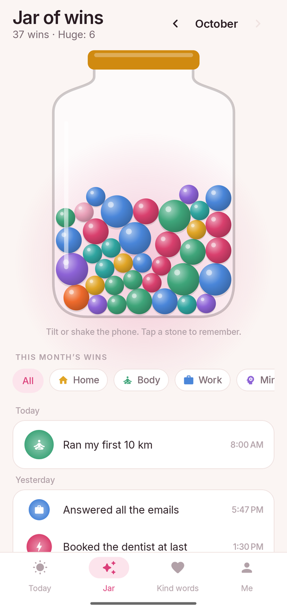
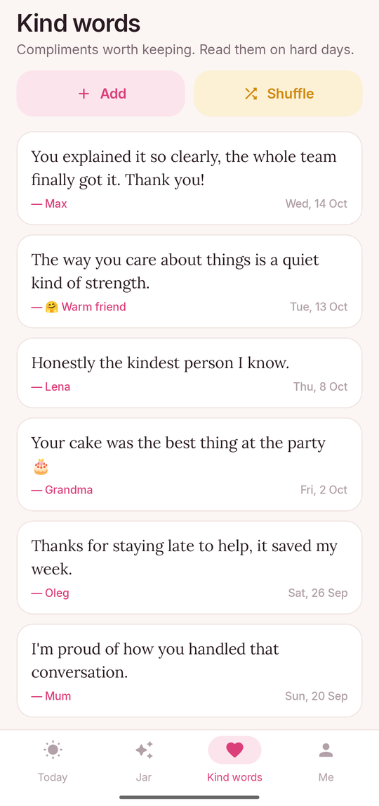
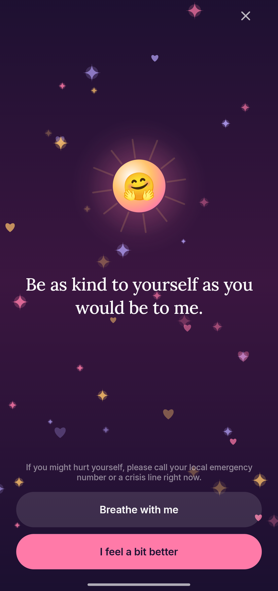
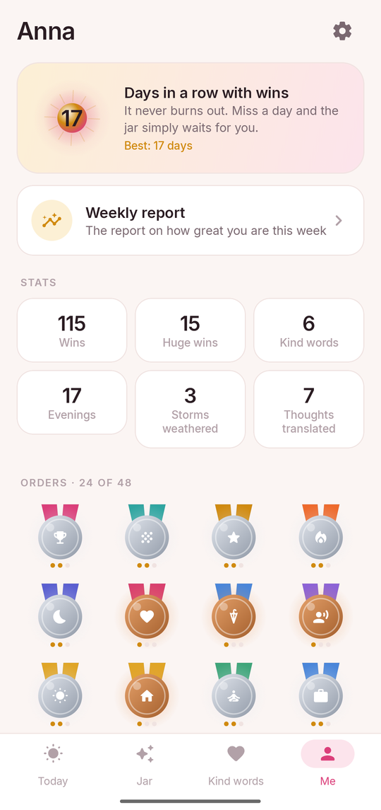
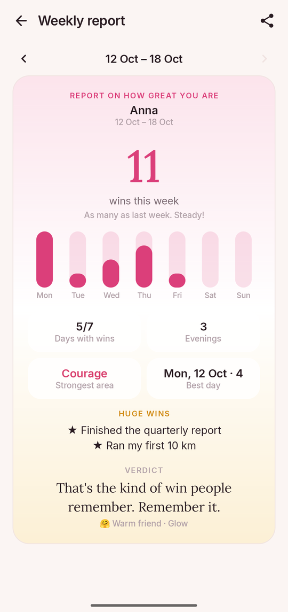
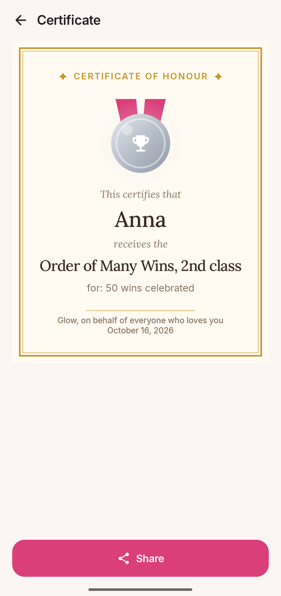

<div align="center">


# Glow

### Every win deserves a little praise

*Write down what you did, from washing the dishes to landing the job, and get praised for it. A jar that fills with your wins, five voices to cheer you on, an SOS for hard moments and a translator for your inner critic. Free, no ads, no account, works offline.*

[](https://github.com/bigdevwhale/glow/actions/workflows/android.yml)
[](https://github.com/bigdevwhale/glow/releases/latest)


[](LICENSE)

**English** · [Русский](README.ru.md) · [Website](https://bigdevwhale.github.io/stillcraft/apps/glow/) · [Changelog](CHANGELOG.md)



</div>

---

## The idea

Most of what we do every day goes unnoticed, especially by ourselves. The inner critic speaks up the moment something goes wrong, and stays quiet when things go right.

Glow is the other voice. Tell it about a win, any win, and it cheers. It keeps your wins in a jar you can shake, keeps the kind things people said about you, and sits with you when it's hard. Nothing to buy, nothing to sign up for, nothing leaves your phone.

## What's inside

| | Feature | How it works |
|---|---|---|
| ✨ | **Praise for every win** | Write what you did and how big it felt: tiny, solid or huge. The praise, the confetti and the vibration grow with it. Quick ideas help on days when "got out of bed" is the win. |
| 🫙 | **A jar of wins** | Each win drops in as a stone coloured by its area. Tilt or shake the phone and the stones roll. Tap one to remember the win and what was said. One jar per month. |
| 🎙️ | **Five voices** | A warm friend, a granny, a sports commentator, a wise mentor or a butler. Each one praises, comforts and says goodnight in its own way. |
| ☀️ | **Praise of the day** | A new one every morning, in a notification and a home-screen widget. Keep it, ask for another, share it. |
| ☂️ | **I feel bad** | A dark, quiet room with drifting sparkles, the kindest words one by one, a soft heartbeat and a breathing circle. |
| 🔁 | **Self-criticism translator** | Write the harsh thought. Glow names the thinking trap (all-or-nothing, name-calling, comparing, shoulds…) and offers a kinder way to say it. Fully offline. |
| 💌 | **Kind words** | Keep compliments from real people, with a screenshot if you like, and read them in shuffle mode on hard days. |
| 🌙 | **Evening of pride** | Three things you're proud of today, collected in a pride diary. |
| 🏅 | **Orders and a weekly report** | 16 orders with three degrees each and a certificate of honour to share. Every Sunday, a report on how great you were this week. |

<table>
  <tr>
    <td></td>
    <td></td>
    <td></td>
    <td></td>
  </tr>
  <tr>
    <td></td>
    <td></td>
    <td></td>
    <td></td>
  </tr>
</table>

## English & Русский

Every screen and every line of praise is written natively in both languages. In Russian, Glow asks whether to speak to you in the masculine or the feminine, so it says «ты сделал» or «ты сделала», never «сделал(а)». Switch in **Settings → Language**; on Android 13+ the app also appears in the system's per-app language settings.

## Not therapy

Glow is a kind companion, not a treatment. If things have felt heavy for a long time, please talk to someone you trust or a professional. If you might hurt yourself, call your local emergency number right away.

## Download

Get the APK from **[Releases](https://github.com/bigdevwhale/glow/releases/latest)**, or the debug APK attached to any [CI run](https://github.com/bigdevwhale/glow/actions/workflows/android.yml). Glow needs Android 8.0 (API 26) or newer.

> [!TIP]
> On Xiaomi (MIUI / HyperOS), Huawei and some other phones, allow **Autostart** and remove battery limits so the morning praise and evening reminder arrive on time.

## Privacy

Glow has no accounts, no servers, no analytics, no ads and no internet permission. Wins, kind words, screenshots and evenings live on the phone. **Settings → Backup** exports everything to one JSON file you keep.

## Under the hood

- **Kotlin + Jetpack Compose**, Material 3 with a custom palette, the Inter and Lora typefaces.
- The jar is a small Verlet physics simulation on a `Canvas`, driven by the accelerometer. The glowing orb, medals, sparkles and confetti are drawn too.
- **Room** stores wins, kind words and evenings; **DataStore** holds the settings.
- Praise lines carry `{n}` for the name and `{сделал|сделала}` marks that resolve by gender.
- The translator matches word stems against ten thinking traps, all on the device.
- Streaks, orders and the weekly report are pure functions of the history (`domain/`), covered by unit tests.

```
app/src/main/java/app/glow/
├── content/     the voices, thinking traps and win ideas (EN + RU)
├── data/        Room database, settings, JSON backup, demo seed
├── domain/      voices, gender forms, stats & streaks, orders, weekly report
├── notify/      morning, evening and Sunday reminders, boot receiver
├── widget/      praise-of-the-day widget
└── ui/          today, jar, kind words, me, onboarding, settings
```

Build it with `./gradlew assembleDebug`. `./gradlew installDebug -Pdemo` installs `app.glow.demo` with made-up wins, the one used for these screenshots.

## License

[MIT](LICENSE). Part of [Stillcraft](https://bigdevwhale.github.io/stillcraft/), small tools for a quieter mind.
