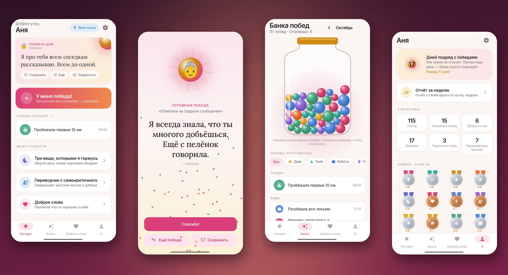
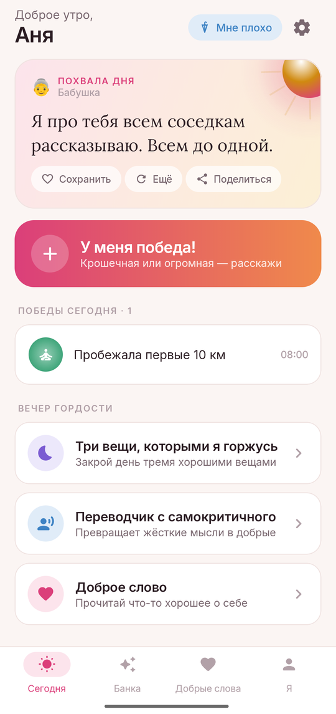
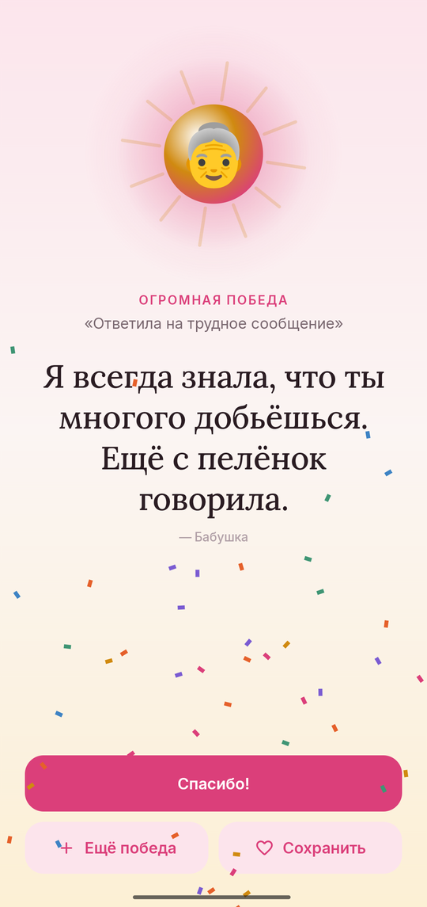
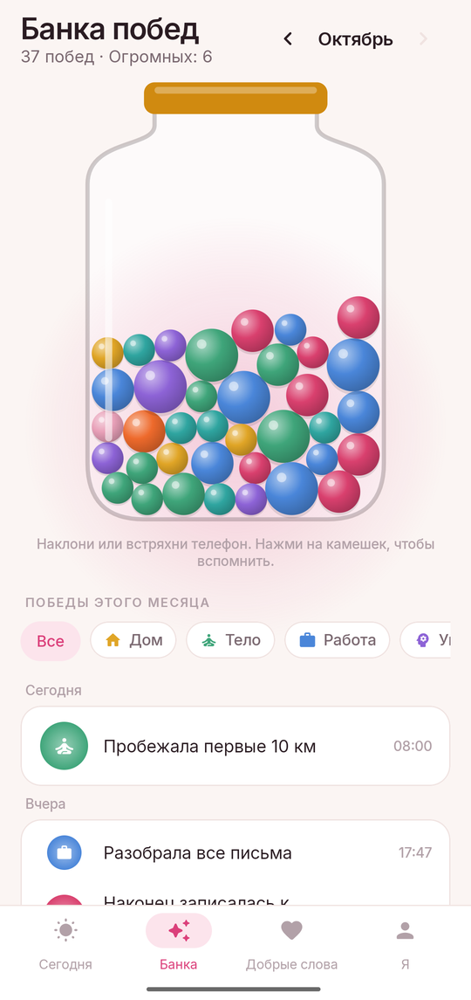
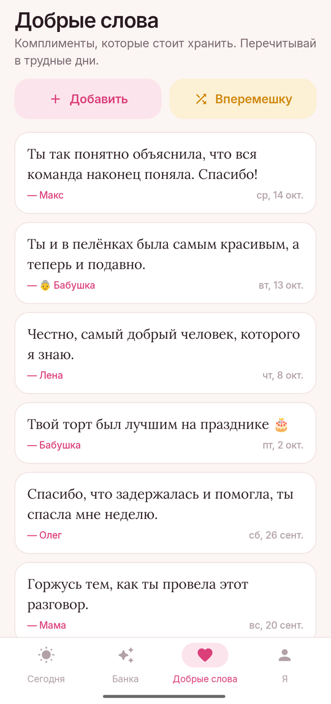
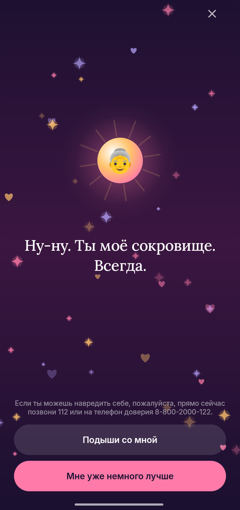
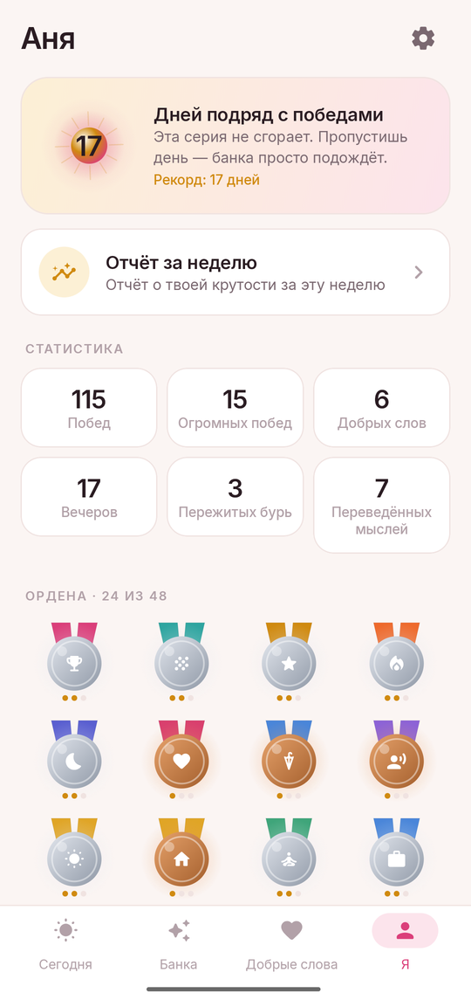
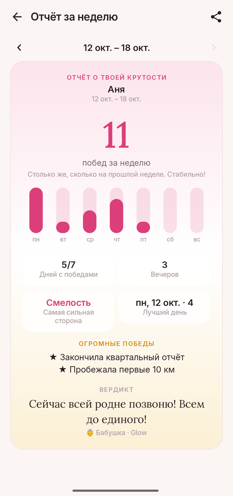
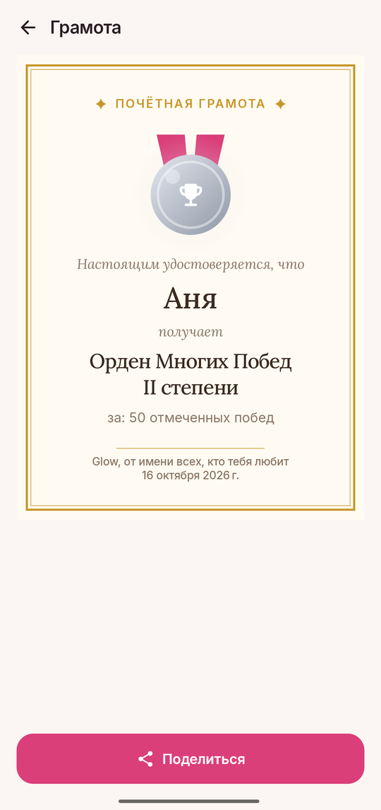

# Glow

### Каждая победа заслуживает похвалы

*Запиши, что у тебя получилось, от помытой посуды до новой работы, и получи за это похвалу. Банка, которая наполняется победами, пять голосов поддержки, SOS для трудных минут и переводчик для внутреннего критика. Бесплатно, без рекламы и аккаунта, работает офлайн.*

[English](README.md) · **Русский** · [Сайт](https://bigdevwhale.github.io/stillcraft/apps/glow/) · [История изменений](CHANGELOG.md)

---

## Идея

Большую часть того, что мы делаем каждый день, никто не замечает. Особенно мы сами. Внутренний критик просыпается, стоит чему-то пойти не так, и молчит, когда всё получается.

Glow — другой голос. Расскажи ему о победе, любой, и он обрадуется. Он хранит твои победы в банке, которую можно встряхнуть, бережёт добрые слова, которые тебе говорили, и побудет рядом, когда тяжело. Ничего не нужно покупать, ни на что не надо подписываться, и ничего не покидает телефон.

## Что внутри

| | Возможность | Как это работает |
|---|---|---|
| ✨ | **Похвала за каждую победу** | Напиши, что получилось и насколько это большое дело: крошечная, хорошая или огромная победа. Похвала, конфетти и вибрация растут вместе с ней. Готовые идеи выручат в дни, когда победа — встать с кровати. |
| 🫙 | **Банка побед** | Каждая победа падает в банку камешком цвета своей сферы. Наклони или встряхни телефон, и камешки покатятся. Нажми на камешек, чтобы вспомнить победу и что о ней сказали. Своя банка на каждый месяц. |
| 🎙️ | **Пять голосов** | Тёплый друг, бабушка, спортивный комментатор, мудрый наставник или дворецкий. Каждый хвалит, утешает и желает спокойной ночи по-своему. |
| ☀️ | **Похвала дня** | Каждое утро новая — в уведомлении и в виджете на главном экране. Сохрани её, попроси другую, поделись. |
| ☂️ | **Мне плохо** | Тёмная тихая комната с плывущими искрами, самые добрые слова одно за другим, мягкий стук сердца и круг для дыхания. |
| 🔁 | **Переводчик с самокритичного** | Напиши жёсткую мысль. Glow назовёт ловушку мышления («всё или ничего», ярлыки, сравнение, долженствования…) и предложит сказать то же самое добрее. Полностью офлайн. |
| 💌 | **Добрые слова** | Храни комплименты от настоящих людей, со скриншотом, если хочешь, и перечитывай их вперемешку в трудные дни. |
| 🌙 | **Вечер гордости** | Три вещи, которыми ты гордишься сегодня, собираются в дневник гордости. |
| 🏅 | **Ордена и отчёт за неделю** | 16 орденов по три степени и почётная грамота, которой можно поделиться. По воскресеньям — отчёт о твоей крутости за неделю. |

<table>
  <tr>
    <td></td>
    <td></td>
    <td></td>
    <td></td>
  </tr>
  <tr>
    <td></td>
    <td></td>
    <td></td>
    <td></td>
  </tr>
</table>

## Русский & English

Каждый экран и каждая похвала написаны на обоих языках с нуля. По-русски Glow спрашивает, обращаться к тебе в мужском или женском роде, и пишет «ты сделал» или «ты сделала», а не «сделал(а)». Язык меняется в **Настройки → Язык**; на Android 13+ приложение есть и в системных настройках языка для приложений.

## Это не терапия

Glow — добрый спутник, а не лечение. Если тяжело уже долго, пожалуйста, поговори с близким человеком или специалистом. Если ты можешь навредить себе, сразу звони 112 или на телефон доверия 8-800-2000-122.

## Скачать

APK — в **[Releases](https://github.com/bigdevwhale/glow/releases/latest)**, или отладочный APK из любого [запуска CI](https://github.com/bigdevwhale/glow/actions/workflows/android.yml). Нужен Android 8.0 (API 26) или новее.

> [!TIP]
> На Xiaomi (MIUI / HyperOS), Huawei и некоторых других телефонах разреши **автозапуск** и сними ограничения батареи, чтобы утренняя похвала и вечернее напоминание приходили вовремя.

## Приватность

У Glow нет аккаунтов, серверов, аналитики, рекламы и разрешения на интернет. Победы, добрые слова, скриншоты и вечера хранятся на телефоне. **Настройки → Резервная копия** сохраняет всё в один JSON-файл.

## Как устроено

- **Kotlin + Jetpack Compose**, Material 3 со своей палитрой, шрифты Inter и Lora.
- Банка — небольшая физическая симуляция (Verlet) на `Canvas`, которой управляет акселерометр. Светящийся шар, медали, искры и конфетти тоже нарисованы.
- **Room** хранит победы, добрые слова и вечера; **DataStore** — настройки.
- В строках похвалы есть `{n}` для имени и метки `{сделал|сделала}`, которые подставляются по выбранному роду.
- Переводчик ищет основы слов для десяти ловушек мышления, всё на устройстве.
- Серии, ордена и отчёт за неделю — чистые функции истории (`domain/`), покрытые юнит-тестами.

Сборка: `./gradlew assembleDebug`. `./gradlew installDebug -Pdemo` ставит `app.glow.demo` с придуманными победами — на нём сняты эти скриншоты.

## Лицензия

[MIT](LICENSE). Часть [Stillcraft](https://bigdevwhale.github.io/stillcraft/) — маленьких инструментов для спокойного ума.
